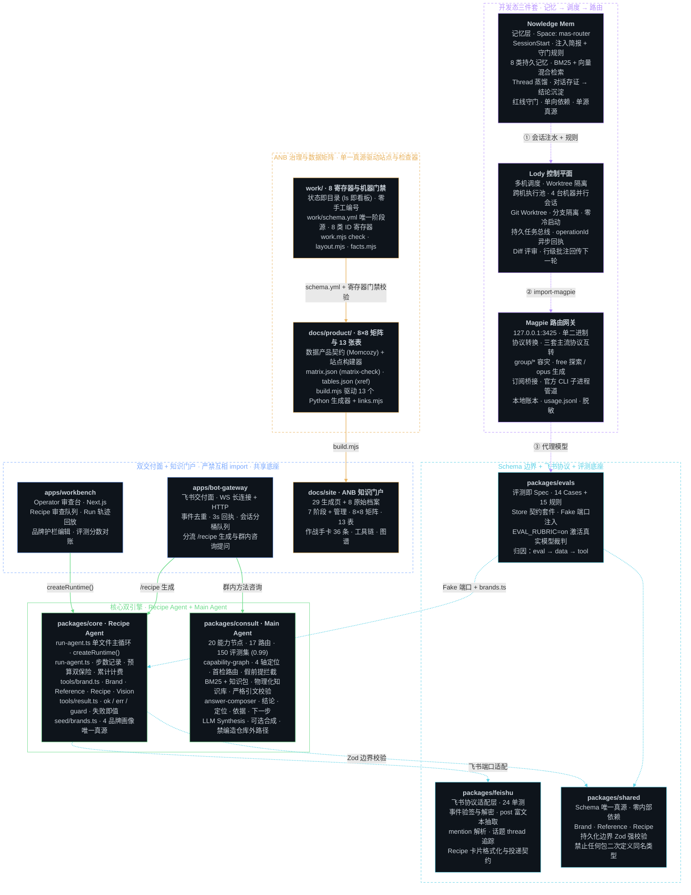

# MAS Router Method 全产品架构全景图

元素：交互入口 (Surfaces) ｜ 核心运行时与咨询引擎 (Engines) ｜ 契约、评测与适配底座 (Contracts & Gates) ｜ ANB 方法论与生成站点 (Methodology & Site) ｜ 本地开发工具链 (Agent Toolchain)  
流向：运行时调用 / 协议转发 ｜ 单向模块依赖 / 契约约束（虚线） ｜ 门禁校验 / 站点生成 ｜ 开发态注入 / 路由代理（虚线）

