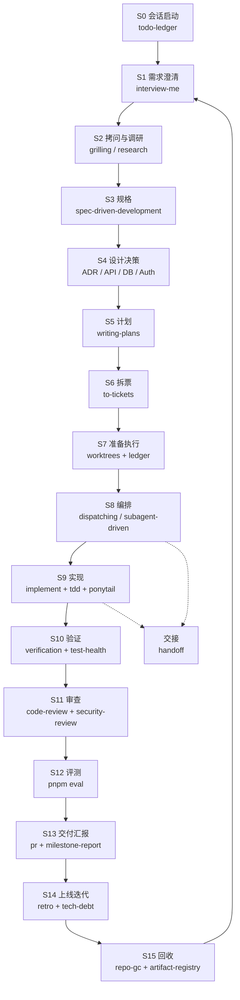

# Skill SOP：从需求澄清到交付迭代

> **v3 说明**：入口是 `agent-delivery-router`（插件提供，调用需带前缀）。本文件的 16 个阶段是「能力车道」的详细展开；只有 G1–G5 五个硬闸门是强制的，其余是清单。链路总览见 [`skill-chain.md`](./skill-chain.md)。
>
> **v3 修正了什么**：v2 及之前，本文的十四个阶段依赖的 skill 里有 42 个不在仓库的 `.claude/skills/` 中。它们并非不存在——绝大多数由客户端插件提供，调用时要带前缀（如 `anthropic-skills:verification-before-completion`）。文档之前没有说明这一点，导致两种实际后果：照着走的人在第一步就找不到命令；一次盘点据此错误地宣称「42 个 skill 不存在」。
>
> **现在怎么判断**：看 [`skill-catalog.md`](./skill-catalog.md) 的「来源」列，标 `插件` 的必须带前缀调用，标 `仓库` 的直接用名字。**如果一个 skill 在本机调用不到，正确结论是「我的客户端没装这个插件」，不是「这个 skill 是假的」。**

本文件是操作手册。它不解释每个 skill 是什么（见 [`skill-catalog.md`](./skill-catalog.md)），只回答一件事：**现在这个阶段，我该说什么、产出什么、什么时候可以进入下一步。**

## 使用说明

### 三条铁律

1. **没有产物就不算完成。** 每个阶段都有落盘文件；只有聊天结论的阶段视为未发生。
2. **人工 gate 不许代答。** `interview-me`、`spec-driven-development`、`to-tickets`、`milestone-report` 的确认必须来自用户。
3. **删除与新增分开。** 任何清理动作独立提交，不与功能混在一起。

### 目录约定

| 产物 | 路径 |
|---|---|
| 意图声明 | `docs/intent/<topic>.md` |
| 规格 | `SPEC-<module>.md` 或 tracker issue |
| 决策记录 | `docs/adr/NNNN-*.md` |
| 术语表 | `GLOSSARY.md` |
| 实施计划 | `docs/superpowers/plans/YYYY-MM-DD-<feature>.md` |
| 票据 | `.scratch/<feature>/issues/NN-*.md` 或 tracker |
| 工作账本 | `.agent/ledger.md` |
| 产物登记 | `docs/artifacts.md` |
| 回收报告 | `docs/gc/YYYY-MM-DD.md` |
| 测试体检 | `docs/tests/health-YYYY-MM-DD.md` |
| 里程碑报告 | `reports/YYYY-MM-DD-<milestone>.html` |
| 交接文档 | `$TMPDIR/handoff-<topic>-<timestamp>.md` |

### 全链路总览

---

## S0 会话启动

**目标**：在写任何代码之前，知道自己站在哪。

- **调用**：`todo-ledger`
- **输入**：上一轮的 `.agent/ledger.md`
- **动作**：读 `Now`、读最后两条 session log、核对分支与 worktree；与 `git log` 不一致时以 git 为准并修正 ledger。
- **输出**：一句状态回报（当前项、下一项、新增阻塞）
- **完成判据**：能说出"现在做什么、为什么是它、上一步验证过什么"
- **衔接 Prompt**：

  > `用 todo-ledger 读一下当前状态，确认分支和 worktree，告诉我 Now 和下一件事。`

**失败分支**：ledger 不存在 → 先用 `handoff` 或 `git log` 重建一版，不要凭记忆开工。

---

## S1 需求澄清

**目标**：把"做个 X"变成一句可验收的意图。

- **调用**：`interview-me`
- **输入**：用户的一句话诉求
- **动作**：先写假设 + 置信度；一次只问一个问题，每个问题带推荐答案；低于 70% 置信度必须说明缺什么；最后复述六要素（Outcome / User / Why now / Success / Constraint / Out of scope）并等明确 yes。
- **输出**：`docs/intent/<topic>.md`（用户确认后才写）
- **完成判据**：用户明确说"是"，且 Out of scope 非空
- **衔接 Prompt**：

  > `意图已确认，存到 docs/intent/<topic>.md。接下来用 grilling 拷问这个方向。`

**失败分支**：用户说"你决定" → 给两个具体选项让其二选一，不要替其决策。

---

## S2 拷问、调研与代码理解

**目标**：在写规格前，把含糊处和事实缺口清空。

- **调用**：`grilling`（或 `grill-with-docs`）、按需 `research`、`graphify`、`codebase-design`
- **输入**：意图声明 + 现有代码/资料
- **动作**：
  1. `grilling` 按 frontier 分轮提问，每轮给推荐答案，直到问不出新问题。
  2. 需要外部事实 → `research`，只引一手来源，落一份 md。
  3. 需要知道代码现状 → `graphify` 查符号与调用链。
  4. 涉及模块边界 → 用 `codebase-design` 的词汇描述。
- **输出**：拷问结论、调研笔记、代码地图；如用 `grill-with-docs`，同时更新 `GLOSSARY.md` 与 ADR
- **完成判据**：没有"到时候再说"的空白；每个关键判断都有事实或决策支撑
- **衔接 Prompt**：

  > `拷问结束，结论和调研都在 <路径>。用 spec-driven-development 写成 spec。`

**失败分支**：问题问不动 → `wayfinder` 画决策地图，先定目的地；或 `prototype` 做一个一次性原型来回答。

---

## S3 规格

**目标**：把共识固化成可验收的规格。

- **调用**：`spec-driven-development`（新项目/新功能）或 `to-spec`（对话已透，只需固化）
- **输入**：意图 + 拷问结论 + 调研 + 代码现状
- **动作**：六个部分写全（目标、命令、结构、风格、测试策略、边界）；把模糊要求改写成可测的成功标准；写入仓库；**写完当轮停止**。
- **输出**：`SPEC-<module>.md` 或 tracker issue（打 `ready-for-agent`）
- **完成判据**：用户批准；成功标准可测；Boundaries 的 Always / Ask first / Never 都有内容
- **衔接 Prompt**：

  > `Spec 已批准。用 architecture-decision-records 把其中难回退的选择记下来，再进入设计。`

**失败分支**：spec 跨了多个可独立验收的能力 → 先出 capability map，按模块递归，不要写一份巨无霸。

---

## S4 设计决策

**目标**：把"怎么做"定到接口、数据、权限层面，并留下决策记录。

- **调用**：`codebase-design`、`api-and-interface-design`、`database-schema-designer`、`auth-implementation-patterns`、`architecture-decision-records`
- **输入**：spec + 现有 schema/接口/权限模型
- **动作**：
  1. 模块边界与 seam：`codebase-design`
  2. 对外契约：`api-and-interface-design`（错误语义、分页、幂等键）
  3. 数据：`database-schema-designer`（约束、索引、可回滚迁移）
  4. 登录与权限：`auth-implementation-patterns`（session/JWT/OAuth 选型、对象级鉴权、租户隔离）
  5. 每个难回退的选择：`architecture-decision-records`，写清放弃的选项和代价
- **输出**：接口契约、schema 与迁移、认证/授权模型、`docs/adr/*.md`
- **完成判据**：一个没参与讨论的工程师能只读这些文件就开始实现
- **衔接 Prompt**：

  > `设计已定，ADR 在 docs/adr。用 writing-plans 把它变成可执行计划。`

**失败分支**：两个方案都合理 → 写 ADR 记录取舍，不要拖到实现时随机选。

---

## S5 计划

**目标**：把 spec 变成别人能照着做的步骤。

- **调用**：`writing-plans`
- **输入**：spec + ADR + 文件结构
- **动作**：先定文件职责，再拆任务；每个任务给精确文件、接口、先失败的测试、验证命令；最后自查 spec 覆盖、步骤可执行性、类型一致性。
- **输出**：`docs/superpowers/plans/YYYY-MM-DD-<feature>.md`
- **完成判据**：计划给一个没看过仓库的人也能执行；没有"TBD / 处理边界情况"这类空话
- **衔接 Prompt**：

  > `计划已保存。用 to-tickets 拆成纵向切片，标清阻塞关系。`

**失败分支**：计划比 spec 长很多 → 说明写成了代码转录，退回只保留接口与测试名。

---

## S6 拆票

**目标**：把计划切成可独立验收、可并行的票。

- **调用**：`to-tickets`
- **输入**：计划
- **动作**：每票切穿所有层（schema/API/UI/测试），能单独演示；标 blocking edges；先给用户看粒度与依赖，批准后再发布。
- **输出**：`.scratch/<feature>/issues/NN-*.md` 或 tracker issue
- **完成判据**：用户确认粒度；每张票都能说清"完成后什么行为可用"
- **衔接 Prompt**：

  > `票据已批准。用 todo-ledger 建账本，再用 using-git-worktrees 准备隔离工作区。`

**失败分支**：一张票跨了多个不相干能力 → 继续拆；纯机械的全仓改名 → 走 expand–contract，不要硬切纵向。

---

## S7 准备执行

**目标**：让工作发生在隔离、可回滚、状态可见的环境里。

- **调用**：`todo-ledger`、`using-git-worktrees`、按需 `artifact-registry`
- **输入**：票 + 当前分支
- **动作**：建/更新 ledger（Now 只能一项）；建 worktree 并确认目录被 ignore；装依赖；跑基线测试；本次要新增的脚本/探针/开关先登记。
- **输出**：worktree、`.agent/ledger.md`、`docs/artifacts.md` 新行
- **完成判据**：基线测试通过；ledger 与 git 一致
- **衔接 Prompt**：

  > `工作区就绪、基线绿。用 dispatching-parallel-agents 判断这几张票怎么并行。`

**失败分支**：基线本来就是红的 → 先停下问用户，不要在红基线上开工。

---

## S8 编排

**目标**：决定哪些并行、哪些串行，以及谁来做、谁来审。

- **调用**：`dispatching-parallel-agents`、`subagent-driven-development`、`implement-spec`
- **输入**：票图 + worktree + ledger
- **动作**：
  - 互不依赖且不写同一批文件 → 并行派发，每个子任务一个聚焦 prompt。
  - 单票内部 → `subagent-driven-development`：每票一个 fresh implementer，一票一审，ledger 记录。
  - 整个 spec 多票 → `implement-spec`：集成分支 + frontier + 合并 + 终审。
- **输出**：派发记录、每票的实现报告与审查结论、ledger 更新
- **完成判据**：没有两个写入者碰同一批文件；每票都有独立审查
- **衔接 Prompt**：

  > `并行方案已定。开始实现：每票用 implement，内部走 tdd。`

**失败分支**：subagent 不可用 → 自己按 frontier 串行做，保留"每票一审"的原则。

---

## S9 实现

**目标**：用最小完整改动把票做完。

- **调用**：`implement`（单票）/ `implement-spec`（整体）、`tdd`、`ponytail`、`reuse-first`、`karpathy-guidelines`
- **输入**：一张票 + 已确认的 seam
- **动作**：
  1. 读票，复述交付物。
  2. 加依赖或写工具前先 `reuse-first`。
  3. `tdd` 红→绿，一次一个纵向切片。
  4. `ponytail` 控制范围：不加没人要的抽象、配置和"以后可能用"的代码。
  5. 每切片 typecheck + 定向测试；结束时跑全量。
- **输出**：代码 + 测试 + 提交
- **完成判据**：测试通过、typecheck 干净、diff 只包含这张票需要的内容
- **衔接 Prompt**：

  > `实现完成。用 verification-before-completion 跑验证，再进审查。`

**失败分支**：实现中发现票写错了 → 回到 S6 改票，不要在代码里偷偷扩大范围。

---

## S10 验证

**目标**：用证据而不是感觉证明它工作。

- **调用**：`verification-before-completion`、`test-suite-health`、`diagnosing-bugs`
- **输入**：改动 + 可执行命令
- **动作**：跑完整命令、读完整输出、看退出码；标注证据层级（单测 / 集成 / 评测 / 生产）；测试套件变慢或变脆时做一次体检。
- **输出**：命令 + 原始输出 + 结论；必要时 `docs/tests/health-*.md`
- **完成判据**：每个"通过"都附新鲜输出；没有"应该可以"
- **衔接 Prompt**：

  > `验证通过，输出在 <位置>。用 code-review 审 Standards 和 Spec 两条轴。`

**失败分支**：找不到能变红的验证方式 → 先用 `diagnosing-bugs` 建反馈回路，不要直接改代码。

---

## S11 审查

**目标**：在合并前，从规范、规格、精简、安全四个角度看一遍。

- **调用**：`code-review`、`ponytail-review`、`security-review`
- **输入**：diff + 固定基点 + spec
- **动作**：
  1. `code-review`：Standards 与 Spec 两条轴并行，分开报告，不合并排序。
  2. `ponytail-review`：这次改动里有没有本可以不写的代码。
  3. `security-review`：只看高置信度漏洞；Agent 产品额外查 prompt injection、工具越权、租户泄漏。
- **输出**：三份报告；问题清单
- **完成判据**：没有未处理的 Critical / Important；没有高置信度漏洞；Lean 建议已裁决
- **衔接 Prompt**：

  > `审查通过。跑评测：pnpm --filter @mas/evals eval -- --case <id>，和基线比。`

**失败分支**：审查发现设计问题 → 回到 S4，不要用补丁掩盖。

---

## S12 评测

**目标**：证明 Agent 的判断没有变差。**单元测试通过不等于这一票完成。**

- **调用**：本项目 `packages/evals`（暂无对应 skill，这是已知缺口）
- **输入**：prompt / 工具 schema / 模型 / 数据形态的改动
- **动作**：跑相关 case；与基线对比；回归要能解释；新增判断维度时先补 case 再改实现。
- **输出**：评测结果表（case、通过率、成本、延迟）
- **完成判据**：基线达标，或回归有明确解释并被接受
- **衔接 Prompt**：

  > `评测达标。用 pr 写 PR 正文，再更新 ledger 和里程碑。`

**失败分支**：评测集本身不可信 → 先修 eval，不要用不可信的分数做发布决定。

---

## S13 交付与汇报

**目标**：让合并与汇报都建立在证据上。

- **调用**：`pr`、`milestone-report`、`todo-ledger`
- **输入**：diff、验证输出、评测结果、ADR、ledger
- **动作**：PR 用最小视图 + 前后证据 + 合并风险；里程碑报告一页 HTML，先给结论，再给指标、交付、证据、风险、下一步；ledger 把 Done 补上证据。
- **输出**：PR、`reports/YYYY-MM-DD-*.html`、更新后的 ledger
- **完成判据**：每个结论都有产物；报告里有风险项；ledger 的 Done 全部带证据
- **衔接 Prompt**：

  > `已交付。用 retro 复盘这个周期，产出环境改进项。`

**失败分支**：指标拿不到 → 报告里写"未验证"，不要估算一个好看的数字。

---

## S14 上线后迭代

**目标**：用真实使用证据决定下一轮，而不是用意见。

- **调用**：`retro`、`tech-debt`、按需 `deprecation-and-migration`
- **输入**：线上指标（错误、延迟、成本、使用漏斗）、事故记录、会话记录
- **动作**：复盘产出可执行改进项并分配 owner；债务登记打分排序；要下线的旧路径走 expand–contract。
- **输出**：改进项清单、`docs/tech-debt.md` 更新、弃用/迁移计划
- **完成判据**：每项有 owner 和复查日期；没有"以后再说"
- **衔接 Prompt**：

  > `复盘完成。用 repo-gc 做一次回收，把该删的删掉。`

**失败分支**：没有埋点 → 先补观测，再谈迭代；不要用直觉替代数据。

---

## S15 熵控制与交接

**目标**：让仓库在下一轮开始时比这一轮更轻，而不是更重。

- **调用**：`artifact-registry`、`test-suite-health`、`repo-gc`、`ponytail-audit`、`handoff`
- **输入**：过期登记、测试体检、全仓审计、ledger
- **动作**：
  1. 过一遍到期产物：续期或删除。
  2. 测试体检给出 stale test 候选。
  3. `repo-gc` 出报告：E1–E4 分级，Delete / Verify / Keep。
  4. 用户批准后，按类别分批删除，每批独立提交，删前删后各跑一次全量测试。
  5. 会话结束：`handoff` 写交接，`todo-ledger` 写最后一条 session log。
- **输出**：`docs/gc/<date>.md`、删除提交、`docs/artifacts.md` 清理、交接文档
- **完成判据**：每个删除都有证据等级；回滚只需一次 revert；交接文档能让新 agent 直接开工
- **衔接 Prompt**：

  > `回收完成。用 handoff 收尾，下一轮从 todo-ledger 和 interview-me 重新开始。`

---

## 节奏

| 频率 | 动作 | Skill |
|---|---|---|
| 每个会话开始 | 读账本、核对分支 | `todo-ledger` |
| 每个会话结束 | 写 session log、必要时交接 | `todo-ledger` + `handoff` |
| 每张票 | 实现 → 验证 → 审查 | `implement` + `tdd` + `verification-before-completion` + `code-review` |
| 每次合并前 | 安全审查；触及 Agent 行为则跑评测 | `security-review` + `pnpm eval` |
| 每个里程碑 | 一页 HTML 汇报；全仓回收；测试体检 | `milestone-report` + `repo-gc` + `test-suite-health` |
| 每季度 | 依赖与 skill 更新；债务重排 | `tech-debt` + `npx skills check` |

## 常见断点与修复

| 现象 | 根因 | 修复 |
|---|---|---|
| 聊得很顺，但一周后没人记得为什么 | 决策只在对话里 | 回 S4 补 ADR；用 `grill-with-docs` 重跑关键决策 |
| 票做完了但不知道算不算完成 | 没有验收标准 | 回 S3 补可测的成功标准；用 `verification-before-completion` 重新定义证据 |
| 多个会话互相覆盖 | 没有 worktree 与账本 | 回 S7；`using-git-worktrees` + `todo-ledger` |
| 测试越来越多、越来越慢 | 没有测试预算 | `test-suite-health`，删同义反复与重复覆盖 |
| 旧代码不敢删 | 没有弃用流程 | `deprecation-and-migration`，量化消费者后 expand–contract |
| 脚本/探针/开关越积越多 | 没有登记与到期 | `artifact-registry` + 每里程碑 `repo-gc` |
| 报告写得漂亮但没人信 | 结论没有证据 | `milestone-report` 的"未验证"标记；回 S10 补输出 |

## 与仓库现有 `.claude/skills` 的关系

本项目已 vendor 了 Matt Pocock 的工程 skill 与 `native-agent-dev` 阶段路由。规则是：**项目级优先**。

- 项目里已有同名 skill（如 `tdd`、`code-review`、`implement`、`diagnosing-bugs`）时，用项目版本。
- 本文档描述的全局版本用于仓库外的工作，或项目版本缺失时兜底。
- `native-agent-dev` 是项目自己的阶段路由，进入本仓库的任务应优先走它；本文档提供的是跨项目的通用链路与产物约定。
